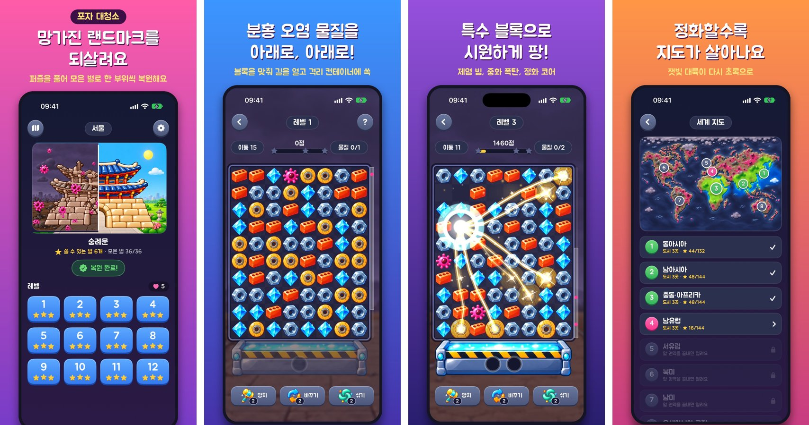

# 포자 대청소 (SporeSweep)

외계 포자에 덮인 세계의 랜드마크를 매치3 퍼즐로 정화하고 복원하는 모바일 게임입니다. iOS 판(Swift)과 안드로이드·웹 판(Kotlin)이 있고, 규칙과 기능이 같습니다. 안드로이드와 웹은 코드 한 벌을 함께 씁니다.
8개 권역, 24개 도시, 380개 레벨이 들어 있습니다.



*화면 네 개를 붙인 홍보용 그림입니다. 랜드마크의 폐허와 복원된 모습을 반씩 합친 부분은 홍보용으로 만든 것이고, 게임 안에 이런 비교 화면은 없습니다.*

> 열람과 학습을 위해 공유한 저장소입니다. 다시 배포하거나 공개하지 말아 주세요. 자세한 것은 [LICENSE](LICENSE)에 있습니다.

## 한눈에 보기

| | |
| --- | --- |
| 플랫폼 | iOS 17 이상, Android 8.0(API 26) 이상, 웹(Kotlin/Wasm). 세로 화면 |
| 언어와 도구 | iOS: Swift 6, SwiftUI(화면), SpriteKit(보드), Xcode 27<br>안드로이드: Kotlin, Jetpack Compose(화면), 직접 만든 작은 그리기 엔진(보드), Gradle |
| 규칙 | 특수 블록 3종과 조합 6종, 장애물 17종(콘크리트와 강화 콘크리트를 따로 센 수), 아이템 3종 |
| 메타 | 별을 모아 랜드마크를 부위별로 복원, 정화한 만큼 초록으로 돌아오는 지도 |
| 수익 장치 | 생명(5개, 30분에 하나), 보상형 광고(AdMob) |
| 측정 | Firebase Analytics |
| 언어 | 한국어, 영어 |
| 테스트 | iOS 513개, 안드로이드 36개(그중 하나가 iOS 판과 399레벨의 규칙이 같은지 비교) |

게임의 규칙과 구조는 모두 [DESIGN.md](DESIGN.md)에 적혀 있습니다. 코드를 읽기 전에 1~2장을 먼저 보면 좋습니다.

## 폴더

```
SporeSweep/          앱. SwiftUI 화면, 진행·생명·광고·기록을 묶는 AppModel
GameCore/            규칙. 화면과 무관한 순수 Swift 패키지(보드, 매치, 장애물, 점수)
GameScene/           보드를 그리는 SpriteKit 씬. 블록 그림, 효과음, 음악이 들어 있다
LevelData/           레벨 JSON 380개와 읽는 코드, 레벨을 만들고 점검하는 도구
Progress/            진행 저장. 별, 생명, 일일 보상
Config/              사람마다 다른 빌드 설정(서명 팀, 광고 ID)
Tools/               그림·소리·번역·홍보물을 만드는 스크립트
Art/                 그림을 만들 때 쓴 지시문과 견본
Reports/             봇으로 돌린 레벨 점검 결과
Docs/                README에 쓰는 그림
android/             안드로이드 판. core(규칙·레벨·진행, 순수 Kotlin)와 app(화면·보드·소리·광고)
DESIGN.md            기획서. 규칙, 데이터 형식, 기술 구조
```

패키지는 아래로만 의존합니다.

```
SporeSweep(앱) → GameScene → GameCore
              → LevelData → GameCore
              → Progress
```

`GameCore`는 UIKit도 SpriteKit도 쓰지 않습니다. 규칙을 고치고 `swift test`로 바로 확인할 수 있습니다.

## 빌드(iOS)

1. Xcode 27 이상에서 `SporeSweep.xcodeproj`를 엽니다.
2. 처음 열면 Firebase와 Google Mobile Ads 패키지를 내려받습니다. 몇 분 걸립니다.
3. 시뮬레이터를 고르고 실행합니다(⌘R).

아무 설정 없이 시뮬레이터에서 돌아갑니다. 이 상태에서는 광고가 구글의 시험 광고로 나오고, 플레이 기록은 어디로도 보내지 않습니다.

편집기에 "Cannot find … in scope" 같은 표시가 보이면 한 번 빌드(⌘B)하면 사라집니다.

### 실제 기기에 설치하려면

1. `Config/Local.example.xcconfig`를 `Config/Local.xcconfig`로 복사하고 자기 개발 팀 ID를 적습니다.
2. 타깃의 번들 ID(`app.code404.sporesweep`)를 자기 것으로 바꿉니다.

`Local.xcconfig`는 저장소에 올라가지 않습니다.

### 선택 설정

| 하고 싶은 것 | 방법 |
| --- | --- |
| 플레이 기록 보내기 | 자기 Firebase 프로젝트의 `GoogleService-Info.plist`를 `SporeSweep/`에 넣는다. 디버그 빌드는 실행 인자 `-analytics 1`을 줄 때만 보낸다 |
| 자기 광고 단위 쓰기 | `Config/Local.xcconfig`에 `GAD_APPLICATION_ID`와 `REWARDED_AD_UNIT_ID`를 적는다. 디버그 빌드와 TestFlight 빌드는 시험 광고를 쓴다. 출시 빌드가 어디서 받은 앱인지 알아내지 못하면 실제 광고 단위를 쓴다(출시한 앱에 시험 광고가 나가지 않게). 그러니 출시 빌드를 직접 기기에 설치해 시험할 때는 광고를 누르지 않는다 |
| 광고 없이 돌리기 | 실행 인자 `-fakeAds 1` |

## 안드로이드와 웹

안드로이드 판은 iOS 판을 Kotlin으로 옮긴 것입니다. 웹판은 같은 Kotlin 코드를 브라우저(Kotlin/Wasm)에서 돌립니다. 규칙의 기준은 늘 iOS 판이고, 그림·소리·레벨 파일은 빌드할 때 iOS 폴더에서 가져옵니다. 옮긴 과정과 iOS와 다른 점은 [android/PORTING.md](android/PORTING.md)에 있습니다.

```
android/core/        규칙 엔진, 레벨 읽기, 진행 저장. JVM과 웹(Wasm)으로 함께 빌드한다
android/game/        화면, 보드(stage/ 그리기 엔진과 board/), 앱 상태. 안드로이드와 웹이 함께 쓴다(Compose Multiplatform)
android/app/         안드로이드 앱. 시작 화면, 소리·저장 구현, 광고, 기록
android/web/         웹판. 파일 받기, 소리, 브라우저 저장소
```

1. JDK 17 이상과 Android SDK(명령줄 도구 또는 Android Studio)를 준비합니다. SDK 위치는 `android/local.properties`의 `sdk.dir`에 적습니다.
2. 빌드합니다.

```bash
cd android && ./gradlew :app:assembleDebug
```

3. 기기나 에뮬레이터에 설치합니다.

```bash
cd android && ./gradlew :app:installDebug
```

아무 설정 없이 돌아갑니다. 광고는 구글의 시험 광고로 나오고, 플레이 기록은 어디로도 보내지 않습니다.

| 하고 싶은 것 | 방법 |
| --- | --- |
| 플레이 기록 보내기 | 자기 Firebase 프로젝트의 `google-services.json`을 `android/app/`에 넣는다. 디버그 빌드는 실행 인자 `--ez analytics true`를 줄 때만 보낸다 |
| 자기 광고 단위 쓰기 | `android/config.example.properties`를 `config.properties`로 복사해 ID를 적는다. 실제 광고는 출시 빌드에서만 나온다 |
| 개발용 실행 인자 | iOS와 이름이 같다. `adb shell am start -n app.code404.sporesweep/dev.code404.sporesweep.MainActivity --es city tokyo --ei level 2 --ez autoplay true` |
| 웹판 만들기 | `cd android && ./gradlew :web:webSite` → `android/web/build/site`. 정적 파일이라 아무 웹 서버에나 올리면 된다. 자세한 것은 PORTING.md의 "웹판" |
| 웹판의 플레이 기록 | `android/web/firebase-config.example.js`를 `firebase-config.js`로 복사해 자기 Firebase 웹 앱의 값을 적는다 |

## Claude Code mods판

Claude Code 안에서 하는 작은 판입니다. `mods/sporesweep`에 있고, 규칙은 다른 판과 같은 엔진(Kotlin을 순수 자바스크립트로 빌드한 것)입니다. 보드는 이모지와 색깔 칸으로 그리고, 블록을 마우스로 끌거나 방향키로 둡니다. 창이 넓으면 옆에 블록 설명이 나옵니다.

### 설치해서 하기

배포용 저장소 [sporesweep-mod](https://github.com/twobeansdaddy-hue/sporesweep-mod)에서 설치합니다. Claude Code 터미널에서 입력하고, `Add marketplace?`에는 `y`, 범위는 그대로 Enter를 누릅니다.

```
/plugin install sporesweep --marketplace twobeansdaddy-hue/sporesweep-mod
```

셸에서 설치하려면:

```bash
claude plugin install sporesweep --marketplace twobeansdaddy-hue/sporesweep-mod
```

Claude 데스크톱 앱의 Code 탭에서는 `/plugin`이 동작하지 않습니다. 입력창 옆의 **+** → **Plugins** → **Add marketplace**에 `twobeansdaddy-hue/sporesweep-mod`를 넣고, **Add plugin**으로 `sporesweep`을 추가합니다.

설치한 뒤 `/sporesweep`을 입력하고 **🎮 이어하기**를 누릅니다. 블록을 마우스로 잡고 옆 칸으로 끌면 바뀝니다(키보드: 방향키로 고르고 Enter로 잡은 뒤 방향키로 밀기, H 힌트, R 다시, M 메뉴).

### 개발하기

1. 엔진과 레벨 데이터를 모읍니다.

```bash
cd android && ./gradlew :mod:modEngine
```

```bash
python3 Tools/make_mod.py
```

2. `claude --plugin-dir mods/sporesweep`로 Claude Code를 열고 `/sporesweep`을 입력합니다.

시험은 `claude plugin test mods/sporesweep`입니다(터미널과 데스크톱 화면에서 이어하기, 키보드와 끌기로 한 수 두기, 힌트, 진행 저장).

3. 고친 것을 배포용 저장소에 옮깁니다. `sporesweep-mod`를 받아 둔 폴더에 `mods/sporesweep`를 복사하고(`.claude-plugin/marketplace.json`, `README.md`, `.gitignore`는 그쪽 것을 둡니다) 커밋해 올립니다. 이 개발 폴더를 `--plugin-dir`로 여는 컴퓨터에는 배포판을 설치하지 않습니다. 같은 mods가 두 번 들어갑니다.

## 테스트

패키지마다 따로 돌립니다.

```bash
cd GameCore && swift test
```

```bash
cd GameScene && swift test
```

```bash
cd LevelData && swift test
```

```bash
cd Progress && swift test
```

| 패키지 | 테스트 | 보는 것 |
| --- | --- | --- |
| GameCore | 322 | 매치, 낙하, 특수 블록, 장애물, 점수, 아이템 |
| LevelData | 109 | 380개 레벨을 모두 읽고 규칙에 맞는지 |
| GameScene | 66 | 씬의 배치와 연출 |
| Progress | 34 | 저장, 생명, 일일 보상, 진행 합치기 |

안드로이드는 한 번에 돌립니다.

```bash
cd android && ./gradlew :core:allTests
```

| 테스트 | 보는 것 |
| --- | --- |
| ParityTest | iOS 판이 둔 판(399레벨, 15,070수)을 Kotlin으로 다시 두고, 수마다 이벤트·점수·보드·난수 상태가 같은지 |
| 진행 시험 35개 | iOS 판 Progress의 시험을 옮긴 것과 세계 지도 |

규칙을 바꿀 때는 Swift를 먼저 고치고 기준 기록을 다시 만든 뒤 Kotlin을 맞춥니다(PORTING.md).

## 레벨 도구

`LevelData` 패키지에 명령줄 도구가 세 개 있습니다.

| 도구 | 하는 일 |
| --- | --- |
| `levelgen` | 난이도 범위와 장애물 목록을 받아 한 도시의 레벨을 만든다 |
| `levelaudit` | 모든 레벨을 봇 두 종류로 돌려 클리어율을 잰다. `--fix`를 주면 이동 횟수를 고친다 |
| `leveldebug` | 레벨 하나를 글자로 찍어 가며 돌려 본다 |

```bash
cd LevelData && swift run -c release levelaudit --playouts 200 --csv ../Reports/level_audit.csv
```

결과는 [Reports/LEVEL_AUDIT.md](Reports/LEVEL_AUDIT.md)에 있습니다. 레벨 JSON의 형식은 DESIGN.md 9장에 있습니다.

## 개발용 실행 인자

디버그 빌드에서만 동작합니다. Xcode의 Scheme → Run → Arguments에 적습니다. 전체 목록은 DESIGN.md 10장에 있습니다.

| 인자 | 하는 일 |
| --- | --- |
| `-skipTitle 1` | 타이틀과 인트로를 건너뛴다 |
| `-city tokyo -level 5` | 잠금과 상관없이 그 도시의 그 레벨로 들어간다 |
| `-autoplay 1` | 봇이 스스로 판을 둔다 |
| `-allStars 1` | 모든 레벨을 별 3개로 깬 것으로 보고 시작한다 |
| `-lives 0`, `-tools 3` | 생명과 아이템의 수를 정하고 시작한다 |
| `-showcase 1` | 보드에 블록 종류를 늘어놓는다 |
| `-ending 1` | 엔딩에서 시작한다 |
| `-AppleLanguages "(en)"` | 영어로 실행한다 |

이 인자들로 시작한 실행은 진행을 저장하지 않습니다.

## 그림과 소리

- 그림은 모두 AI 이미지 생성으로 만들었습니다. 지시문과 과정은 [Art/PROMPTS.md](Art/PROMPTS.md)에 있습니다.
- 효과음과 음악은 ElevenLabs로 만들었습니다.
- `Tools/`의 스크립트 가운데 그림과 소리를 새로 만드는 것은 각자의 계정이 있어야 돌아갑니다. ElevenLabs 키는 코드에 적지 않고 macOS 키체인에서 읽습니다(`elevenlabs-api-key`).

### Tools

| 스크립트 | 하는 일 |
| --- | --- |
| `make_strings.py` | 영어 번역 파일을 만든다. 새 문장을 넣으면 여기에 번역을 넣고 돌린다 |
| `landmark_shapes.py` | 랜드마크의 부위 영역을 정의하고 Swift 코드를 만든다 |
| `cities_data.py`, `cities_batch.py`, `maps_batch.py`, `install_cities.py` | 도시와 지도의 그림을 한꺼번에 만들고 앱에 넣는다 |
| `key_landmark.py`, `cut_magenta.py`, `cut_chroma.swift`, `cut_sprites.swift`, `split_landmark.py` | 생성한 그림에서 배경을 빼고 조각으로 자른다 |
| `make_icon.py` | 앱 아이콘 |
| `make_sounds.py`, `make_sounds_ai.py`, `make_music_ai.py` | 효과음과 음악 |
| `make_store_shots.py`, `make_promos.py`, `promo_render.swift` | 스토어 스크린샷과 홍보 영상 |
| `record_sim.swift`, `record_audio.swift`, `mux_av.swift` | 시뮬레이터 화면과 소리를 녹화해 합친다 |

## 저장소에 없는 것

- 사업 계획과 홍보 자료, 그림의 원본 작업 파일
- 서명 팀, 실제 광고 ID, Firebase 설정 파일(iOS의 `Config/Local.xcconfig`, `GoogleService-Info.plist`, 안드로이드의 `android/config.properties`, `google-services.json`, 웹의 `android/web/firebase-config.js`), 출시용 업로드 키

DESIGN.md가 `PLAN.md`나 `Marketing/`을 가리키는 곳이 있는데, 그 파일들은 이 저장소에 없습니다.

## 라이선스

열람과 학습용입니다. 다시 배포하거나 상업적으로 쓸 수 없습니다. [LICENSE](LICENSE)를 봐 주세요.
글꼴 Jua는 SIL Open Font License 1.1을 따릅니다.
